# 도화 (Dohwa)

**[English](#english)** | **[한국어](#korean)**

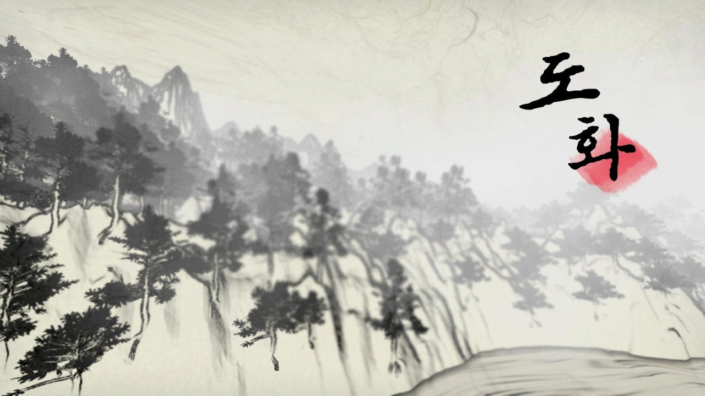

| Skill chain | Boss fight 1 | Boss fight 2 |
| :---: | :---: | :---: |
| 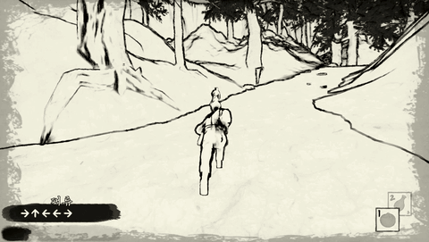 | 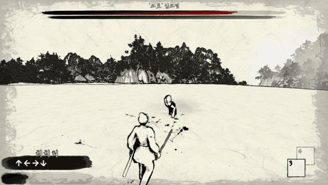 | 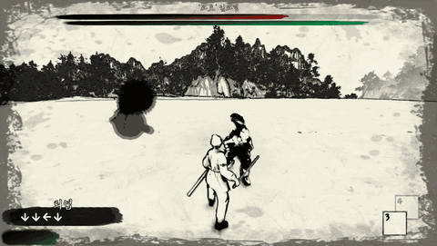 |
| **Death** | **Parry** | **Skill UI** |
| 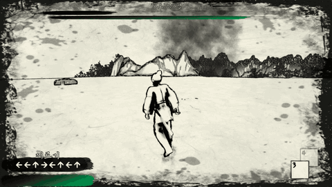 | 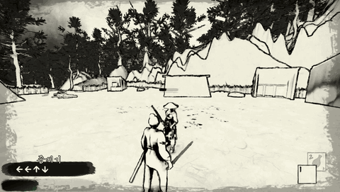 | 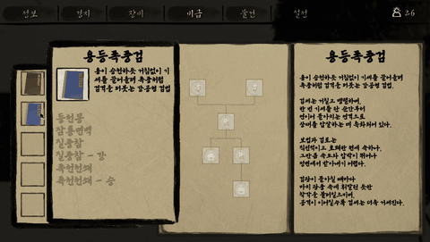 |

 

## English

> An ink-wash style 3D wuxia action game where martial arts are unleashed through command inputs. A two-person team project.

### Project Info

| Item | Details |
| --- | --- |
| Development period | 2026.01 ~ 2026.08 (Demo) |
| Team size | 2 |
| Roles | **Shared**: programming, level design, UI/UX design **Juho Lee**: VFX, SFX **Woojin Song**: modeling, animation |
| Engine | Unity 6 (6000.5.1f1), URP |
| Submitted to | GIGDC 2026 (Production category) |

📄 [GIGDC 2026 summary proposal (PDF, Korean)](docs/GIGDC2026_요약기획서.pdf)

🎬 [Gameplay video (YouTube)](https://youtu.be/RzHhC-BmGhI)

 

### Technical Implementation

#### 1. Command-Based Attack System and Chained Attacks

Skills (forms) are triggered by commands that combine directional and jump inputs.

- Up to 8 inputs are stored in a buffer, and the skill whose command is the longest match with the end of the buffer is triggered.
- While entering inputs, the skills that can follow are shown in real time, and skills without enough MP are shown in a disabled color.
- Skills are defined as ScriptableObjects, with damage, stagger, knockback, and effects specified per hit as an array of classes.
- Memorizing every command would be an unnecessary burden, so **the last input is designed to be the direction the form moves in**.

| Form triggered with footwork (left, down) | Advanced form triggered with footwork (left, down, right, up) |
| :---: | :---: |
| 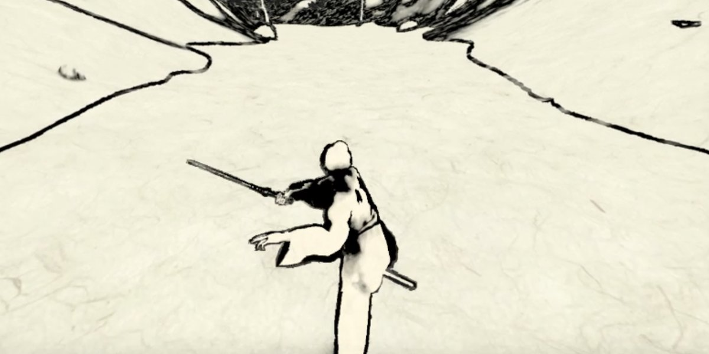 | 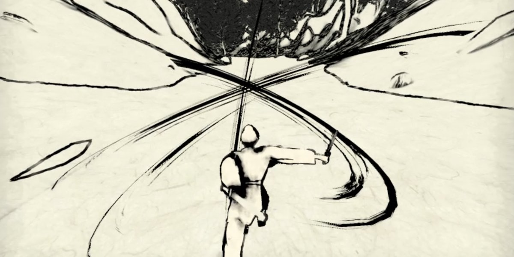 |
| 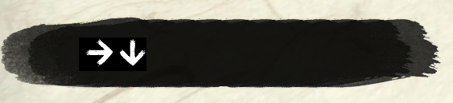 | 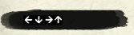 |

#### 2. Enemy: Component Structure Based on the Mediator Pattern

Each enemy is made of **a core plus independent components**. Components never reference each other directly; they communicate only through the **commands (Cmd), queries (Query), and events (On)** of `EnemyCore`.

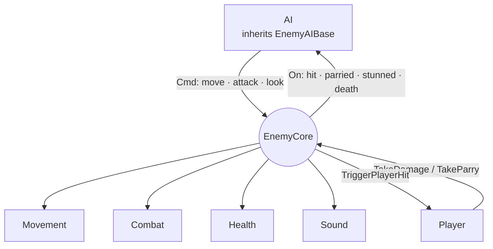

- **Interactions between the player and enemies** also flow through events.
  - Player attack → `TakeDamage` → `OnDamageTaken` → health, combat, and AI each react
  - Player parry → `TakeParry` → `OnParryDamageTaken` → inner energy (MP) drops, and `OnStunned` fires when it reaches 0
- AI classes inherit `EnemyAIBase` and override only the behavior specific to melee, ranged, or boss enemies. Shared logic such as detection, memory, and predictive chasing lives in the base class.

This structure has the following advantages.
- **Extensibility**: When a new reaction is needed, only a component that subscribes to the event is added. The core and existing components are not modified.
- **Separation of roles**: The AI only commands what to do, and each component is responsible for how movement, animation, and sound are carried out.
- **Optional composition**: Different kinds of entities can be created by combining components.

#### 3. Skill Book Collection and Skill Trees

Instead of one huge skill tree, the tree is split into small skill books so that collecting and growth happen together.

The tree is implemented as an array with parent references, and the inventory computes the tree layout automatically to draw the UI.

A new skill book only needs its node array filled in; no layout has to be placed by hand.

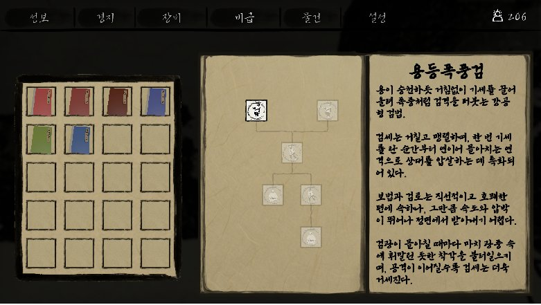

As the player learns skill books and gains enlightenment, their realm rises. The higher the realm, the more the inner peach blossom (dohwa) blooms, granting new abilities.

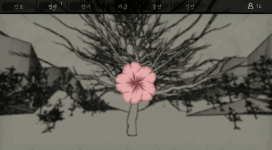

#### 4. Spreadsheet-Linked Balancing and Localization

**Two-way sync between Google Sheets and Unity**

To manage design values in a spreadsheet, I built an editor tool that moves data between the sheet and Unity assets.

- **Google Apps Script API**: A script that accepts GET/POST requests is deployed on the sheet side, and the Unity editor sends requests with `HttpClient`.
- **Push (Unity → Sheet)**: Skill books and skill assets in the project are collected with `AssetDatabase`, split into Active, Passive, and Stat sheets, and sent as JSON. Calculated values that do not exist in the assets, such as per-hit damage, total damage, and damage per MP, are uploaded as well, so skills can be compared for balance directly in the sheet.
- **Pull (Sheet → Unity)**: The JSON response from the sheet is parsed and the values are applied to the ScriptableObjects and enemy prefabs matched by name.
- Requests use `async/await` so the editor does not freeze, and progress is shown with a progress bar. If the response is not valid JSON, nothing is applied and the operation stops.
- **Localized text** is pulled for every string table in the project from a single menu item, using the Google Sheets API of the Unity Localization package.

 

### Graphics

#### Ink-Wash Rendering

A **full-screen shader** that redraws the whole screen in an ink-wash style. Lines, shading, and the background are built separately from the depth and normal information of the rendered scene and then composited.

| | |
| :---: | :---: |
|  | 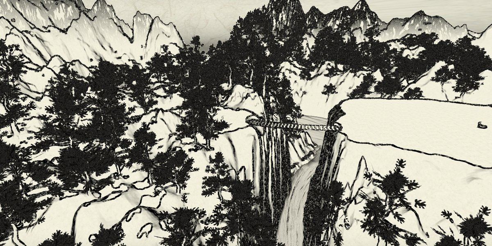 |

**1. Ink lines — Sobel outlines**
- Outlines are detected by applying a Sobel kernel to the depth and normal buffers. (HLSL Custom Function)
- The sampling UV is slightly perturbed with world-space noise so the lines waver as if drawn by hand, and the same noise breaks the lines here and there for a dry-brush look.
- The detection threshold and line density change with distance, so distant scenery is drawn faintly.

**2. Shading — SSAO and ink tone steps**
- Screen-space ambient occlusion (SSAO) is computed in a Custom Function, so shading also forms on moving characters.
- The continuous shading is divided into three steps, each with a different brush texture, to look like real brushwork.

**3. Background — paper texture**
- A paper texture is applied with world-space triplanar mapping, so the texture stays attached to surfaces when the camera moves.

**Development process**

A simple black-and-white shader could not capture the feel of wuxia, so the current ink-wash shader was completed through repeated feedback and revision between the two of us.

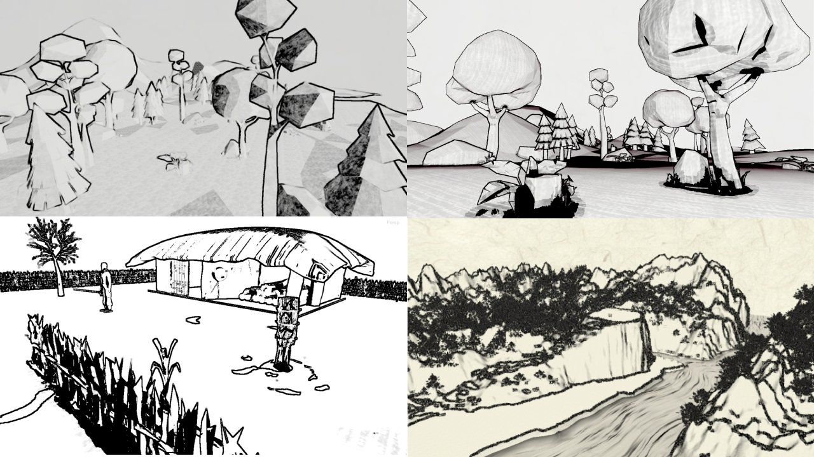

| Position | Stage |
| --- | --- |
| 1 | Outlines and shading implemented in a sample scene |
| 2 | Shadows expressed by applying SSAO |
| 3 | Shader applied to our own models |
| 4 | Final result in the actual game scene, after applying a faded paper texture and fine-tuning the shading |

#### Wounds and Bloodstains

Blood is drawn on characters and terrain with the URP Decal Projector. The player, regular enemies, and bosses share the same component.

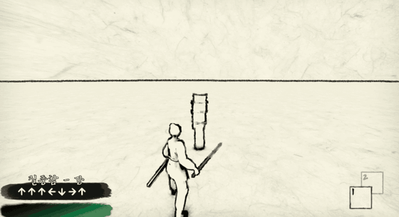

**Wound decals**
- Decals are **attached as children of the character's bones**, so wounds follow the skin as the body moves with animation.
- Size, rotation, and position ranges are set per bone, and each decal's direction is calculated to project toward the center of the bone, so wounds wrap around the torso and limbs.
- An editor menu generates default settings from the rig's bone names, so the system can be applied to a new character right away.

**World decals**
- From the collision events of the blood particles, the hit point, surface normal, and velocity are used to create a decal at that spot.
- The decal is rotated toward the velocity projected onto the surface, so the stain stretches in the direction the blood flew.
- The angle of incidence is obtained from the dot product of the velocity and the normal: blood that falls straight down leaves a round stain, and blood that grazes the surface leaves a long streak.

 

### Optimization

**20 FPS before optimization → 60–70 FPS maintained after**

| Technique | Details |
| --- | --- |
| Terrain grid LOD | The precision of surrounding terrains is recalculated only when the player crosses a terrain boundary. Nearby tiles get the highest precision, and distant tiles are lowered step by step. |
| GPU Instancing | Instancing is applied to the 36 terrain tiles and to the materials of repeated buildings and props to reduce draw calls. |
| Distance-based deactivation | Enemies beyond a certain distance have their AI logic, animator, and renderers turned off, and turned back on when the player approaches. |

 

### Tech Stack

**Unity 6 (6000.5.1f1)** · C# · URP · Shader Graph · Cinemachine 3 · New Input System · AI Navigation · Localization · Timeline · DOTween

 

### Controls

| Action | Key | Action | Key |
| --- | --- | --- | --- |
| Move | `W` `A` `S` `D` | Jump | `Space` |
| Attack | Left mouse button | Guard | Right mouse button |
| Run / Step | `Shift` | Walk | `Ctrl` |
| Lock on | Mouse wheel | Interact | `F` |
| Switch quick slot | `1` `3` | Use quick slot | `2` |
| Inventory | `I` | | |

 

---

## 한국어

> 커맨드 입력으로 무공을 펼치는 수묵화풍 무협 3D 액션 게임, 2인 팀 프로젝트

### 프로젝트 정보

| 항목 | 내용 |
| --- | --- |
| 개발 기간 | 2026.01 ~ 2026.08 (DEMO)|
| 인원 | 2명 |
| 담당 | **공통**: 프로그래밍, 레벨 디자인, UI/UX 디자인 **이주호**: VFX, SFX **송우진**: 모델링, 애니메이션 |
| 엔진 | Unity 6 (6000.5.1f1), URP |
| 출품 | GIGDC 2026 제작부문 |

📄 [GIGDC 2026 요약기획서 (PDF)](docs/GIGDC2026_요약기획서.pdf)

🎬 [플레이 영상 (YouTube)](https://youtu.be/RzHhC-BmGhI)

 

### 기술 구현

#### 1. 커맨드 기반 공격 시스템과 연계 공격

방향키와 점프 입력을 조합한 커맨드로 스킬(초식)을 발동합니다.

- 입력은 최대 8개까지 버퍼에 쌓이고, 버퍼의 끝부분과 가장 길게 일치하는 커맨드의 스킬이 발동합니다.
- 입력 중에는 이어서 발동할 수 있는 스킬이 실시간으로 표시되고, MP가 부족한 스킬은 비활성 색으로 보입니다.
- 스킬은 ScriptableObject로 정의하고, 히트마다 데미지·경직·넉백·이펙트를 클래스 배열로 지정합니다.
- 모든 커맨드를 외우는 것은 불필요한 부담이라 판단해, **마지막 입력이 초식의 진행 방향**이 되도록 설계했습니다.

| 보법(좌하)으로 발동한 초식 | 보법(좌하우상)으로 발동한 고급 초식 |
| :---: | :---: |
|  |  |
|  |  |

#### 2. Enemy: 중재자 패턴 기반 컴포넌트 구조

적 하나는 **코어 + 독립 컴포넌트**로 구성됩니다. 컴포넌트끼리는 서로를 직접 참조하지 않고, `EnemyCore`의 **명령(Cmd), 조회(Query), 이벤트(On)** 로만 소통합니다.

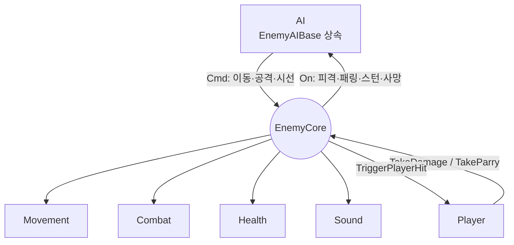

- **플레이어와 적의 상호작용**도 이벤트로 흐릅니다.
  - 플레이어의 공격 → `TakeDamage` → `OnDamageTaken` → 체력·전투·AI가 각자 반응
  - 플레이어의 패링 → `TakeParry` → `OnParryDamageTaken` → 내공 감소, 0이 되면 `OnStunned`
- AI는 `EnemyAIBase`를 상속해 근접·원거리·보스별 행동만 오버라이드합니다. 탐지, 기억, 예측 추격 같은 공통 로직은 베이스에 있습니다.

위 구조는 아래의 장점을 가집니다.
- **확장성**: 새 반응이 필요하면 이벤트를 구독하는 컴포넌트만 추가합니다. Core와 기존 컴포넌트는 수정하지 않습니다.
- **역할 분리**: AI는 무엇을 할지만 명령하고, 이동·애니메이션·사운드의 구현은 각 컴포넌트가 책임집니다.
- **선택적 구성**: 컴포넌트의 조합으로 다양한 유형의 엔티티를 생성할 수 있습니다.

#### 3. 스킬북 수집과 스킬트리

하나의 거대한 스킬트리보다, 잘게 나눈 스킬북을 통해 수집의 재미와 성장을 동시에 가능하도록 합니다.

부모 참조 배열로 트리를 구현하였고, 인벤토리에서 자동으로 트리 구조를 계산하여 UI를 그리도록 하였습니다.

새 스킬북은 노드 배열만 채우면 되고, 레이아웃을 손으로 배치할 필요가 없습니다.

비급을 익히며 깨달음을 얻으면 경지가 오르고, 경지가 높아질수록 내면의 복숭아꽃, 도화가 개화하며 새로운 능력을 얻습니다.

#### 4. 스프레드시트 연동 밸런싱, 로컬라이제이션

**Google Sheets ↔ Unity 양방향 동기화**

기획 수치를 스프레드시트에서 관리할 수 있도록, 시트와 Unity 에셋을 오가는 에디터 툴을 만들었습니다.

- **Google Apps Script API 사용**: 시트 쪽에 GET/POST 요청을 받는 스크립트를 배포하고, Unity 에디터에서는 `HttpClient`로 요청을 보냅니다.
- **Push (Unity → 시트)**: 프로젝트의 스킬북과 스킬 에셋을 `AssetDatabase`로 수집해 액티브·패시브·스탯 시트로 나누어 JSON으로 전송합니다. 이때 타격별 데미지, 총 데미지, MP 대비 데미지 효율처럼 에셋에는 없는 계산값도 함께 올려, 시트에서 스킬 간 밸런스를 바로 비교할 수 있습니다.
- **Pull (시트 → Unity)**: 시트의 JSON 응답을 파싱해 이름으로 대응하는 ScriptableObject와 적 프리팹에 값을 반영합니다.
- 통신은 `async/await`로 처리해 에디터가 멈추지 않고, 진행 상황은 프로그레스 바로 표시합니다. 응답이 올바른 JSON이 아니면 반영하지 않고 중단합니다.
- **다국어 텍스트**는 Unity Localization 패키지의 Google Sheets API를 이용해, 프로젝트의 모든 문자열 테이블을 메뉴 한 번으로 일괄 Pull 합니다.

 

### 그래픽

#### 수묵화 렌더링

화면 전체를 수묵화풍으로 다시 그리는 **풀스크린 셰이더**입니다. 렌더링된 장면의 깊이·노멀 정보로 선, 명암, 바탕을 따로 만든 뒤 합성합니다.

| | |
| :---: | :---: |
|  |  |

**1. 먹선 — Sobel 외곽선**
- 깊이와 노멀 버퍼에 Sobel 커널을 적용해 윤곽을 검출합니다. (HLSL Custom Function)
- 샘플링 UV를 월드 기준 노이즈로 미세하게 흔들어 선이 손으로 그은 듯 떨리고, 같은 노이즈로 선을 군데군데 끊어 갈필 느낌을 냅니다.
- 거리에 따라 검출 기준과 선의 농도를 조절해 먼 풍경은 옅게 그립니다.

**2. 명암 — SSAO와 농담 단계**
- 스크린 스페이스 앰비언트 오클루전(SSAO)을 Custom Function으로 계산해, 움직이는 캐릭터에도 음영이 맺히게 했습니다.
- 연속적인 음영을 3개의 단계로 나누고, 단계마다 다른 붓 텍스쳐를 입혀 실제 붓처럼 연출합니다.

**3. 배경 — 종이 질감**
- 월드 좌표 기반 트라이플래너로 종이 텍스처를 입혀, 카메라가 움직여도 질감이 표면에 붙어 있습니다.

**개발 과정**

단순한 흑백 셰이더로는 무협의 느낌을 살릴 수 없어, 팀원 간 피드백과 수정을 반복하며 지금의 수묵화 셰이더를 완성했습니다.

| 위치 | 단계 |
| --- | --- |
| 1 | 샘플 씬에서 외곽선과 명암 처리 구현 |
| 2 | SSAO를 적용해 그림자 표현 |
| 3 | 직접 제작한 모델에 셰이더 적용 |
| 4 | 실제 게임 씬, 빛바랜 종이 질감 적용과 명암 세부 조정 후 최종 결과 |

#### 상처와 핏자국

URP Decal Projector로 캐릭터와 지형 위에 피를 그립니다. 플레이어, 일반 적, 보스가 같은 컴포넌트를 공유합니다.

**상처 데칼**
- 데칼을 캐릭터의 **뼈(Bone)에 자식으로 붙여**, 애니메이션으로 몸이 움직여도 상처가 피부를 따라 움직입니다.
- 뼈마다 크기·회전·위치 범위를 따로 지정하고, 데칼이 뼈 중심을 향해 투영되도록 방향을 계산해 몸통과 팔다리를 감싸듯 맺히게 했습니다.
- 리그의 뼈 이름으로 기본 설정을 자동 생성하는 에디터 메뉴를 두어, 새 캐릭터에도 바로 적용할 수 있습니다.

**월드 데칼**
- 피 연출 파티클의 충돌 이벤트에서 충돌 지점, 표면 법선, 속도를 받아 그 자리에 데칼을 생성합니다.
- 속도를 표면에 투영한 방향으로 데칼을 회전시켜, 피가 튄 방향으로 길게 남습니다.
- 속도와 법선의 내적으로 입사각을 구해, 수직으로 떨어진 피는 둥글게, 비스듬히 스친 피는 길게 늘어난 자국이 됩니다.

 

### 최적화

**최적화 전 20 FPS → 최적화 후 60~70 FPS 유지**

| 기법 | 내용 |
| --- | --- |
| Terrain 그리드 LOD | 플레이어가 터레인 경계를 넘을 때만 주변 터레인의 정밀도를 다시 계산합니다. 가까운 타일은 최고 정밀도, 먼 타일은 단계적으로 낮춥니다. |
| GPU Instancing | 지형 타일 36개와 반복 배치되는 건물·소품 머티리얼에 인스턴싱을 적용해 드로우콜을 줄였습니다. |
| 거리 기반 비활성화 | 일정 거리 밖의 적은 AI 로직·애니메이터·렌더러를 모두 끄고, 가까워지면 다시 켭니다. |

 

### 기술 스택

**Unity 6 (6000.5.1f1)** · C# · URP · Shader Graph · Cinemachine 3 · New Input System · AI Navigation · Localization · Timeline · DOTween

 

### 조작법

| 동작 | 키 | 동작 | 키 |
| --- | --- | --- | --- |
| 이동 | `W` `A` `S` `D` | 점프 | `Space` |
| 공격 | 마우스 좌클릭 | 가드 | 마우스 우클릭 |
| 달리기 / 스텝 | `Shift` | 걷기 | `Ctrl` |
| 대상 고정 | 마우스 휠 | 상호작용 | `F` |
| 퀵슬롯 이동 | `1` `3` | 퀵슬롯 사용 | `2` |
| 인벤토리 | `I` | | |
